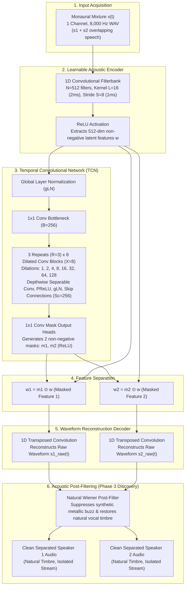

# Comprehensive Project Context: Speaker Separation for the Cocktail Party Problem

**Document Title:** Speaker Separation Project Context, Technical Architecture, Experimental Findings, and Report Preparation Guide  
**Project Name:** ClearParty — Deep Speaker Separation and Multi-Noise Speech Processing  
**Domain:** Monaural (Single-Channel) Blind Source Separation (BSS), Time-Domain Deep Learning  
**Core Models:** Time-Domain Audio Separation Network (Conv-TasNet), Hybrid Conv-TasNet + Wiener Post-Filtering  
**Datasets:** LibriSpeech (`train-clean-100`, `dev-clean`), Libri2Mix (`wav8k/min`), TIMIT Corpus  
**Evaluation Standards:** Scale-Invariant Signal-to-Distortion Ratio (SI-SDR / SI-SDRi), Perceptual Evaluation of Speech Quality (PESQ ITU-T P.862), Short-Time Objective Intelligibility (STOI)  
**Document Purpose:** Serves as the authoritative, permanent, research-quality source of truth for the speaker separation track across all historical conversations and experimental outputs, enabling the immediate drafting of the final project report without information reconstruction.

---

## 1. Project Overview

### 1.1 Problem Statement & Background
The **Cocktail Party Problem**, first coined by Colin Cherry in 1953, describes the remarkable human auditory ability to focus on a single target conversation amidst a cacophony of overlapping speakers and ambient acoustic interference. In digital signal processing, computational replication of this psychoacoustic feat using a single microphone is known as **Monaural (Single-Channel) Blind Speaker Separation (BSS)**.

Mathematically, given an observed single-channel mixture $x(t) \in \mathbb{R}$:
$$x(t) = \sum_{c=1}^{C} s_c(t) + n(t)$$
where $s_c(t)$ represents the clean, uncorrupted speech signal of speaker $c \in \{1, \dots, C\}$, and $n(t)$ denotes additive ambient background noise. For pure speaker separation, $n(t) \approx 0$ and $C = 2$ (dual-speaker cocktail party separation):
$$x(t) = s_1(t) + s_2(t)$$
The objective of the speaker separation system is to recover accurate approximations $\hat{s}_1(t)$ and $\hat{s}_2(t)$ such that each estimated stream isolates one individual voice with zero cross-talk, minimal distortion, and natural vocal timbre.

### 1.2 Motivation and Real-World Applications
Traditional speech processing algorithms assume a single dominant speaker. In real-world multi-talker environments, overlapping speech degrades downstream automated systems:
1. **Automatic Speech Recognition (ASR):** Word Error Rates (WER) explode from under 5% to over 60–80% when two individuals speak simultaneously. Separating speaker streams is a mandatory front-end for transcription.
2. **Teleconferencing & Smart Meeting Rooms:** Enables independent audio level balancing, dynamic speaker tracking, and localized acoustic processing (e.g., Zoom, Microsoft Teams).
3. **Assistive Hearing Devices & Smart Earbuds:** Hearing-impaired individuals struggle severely in social environments; speaker separation enables selective amplification of conversational partners.
4. **Voice-Controlled Human-Machine Interfaces:** Voice assistants (Siri, Alexa, Google Assistant) fail when secondary speakers issue background commands. Separation allows user-specific command routing.

### 1.3 Key Technical Challenges
* **Extreme Time-Frequency Overlap:** Unlike noise (which is often diffuse or stationary), competing human speakers share identical acoustic, formant, and phonetic frequency bands (300 Hz – 3,400 Hz), rendering classical linear filtering and spectral subtraction useless.
* **Underdetermined System:** Reconstructing 2 (or more) independent source signals from a single scalar measurement $x(t)$ is mathematically underdetermined, requiring strong data-driven acoustic priors.
* **The Speaker Permutation Ambiguity Problem:** Neural networks trained with standard mean squared error (MSE) fail because the network does not know whether output head 1 should predict speaker A or speaker B. If the assignment swaps mid-utterance, the gradient cancels out, causing the model to output a muffled average of both voices.
* **Phase Inconsistency in Spectrogram Domain:** Classical Time-Frequency (T-F) masking methods discard or corrupt the acoustic phase, leading to robotic, metallic artifacts when converting back to waveforms via Inverse STFT.
* **Synthetic Metallic Buzz Artifacts:** Deep time-domain masking models frequently introduce high-frequency phase modulation or frame-boundary discontinuity buzz, requiring hybrid acoustic post-processing.

---

## 2. System Architecture and Methodology

### 2.1 End-to-End Speaker Separation Pipeline

### 2.2 Detailed Model Architecture: Scaled Conv-TasNet
The core separation engine is an expanded, high-capacity variant of **Conv-TasNet** (Convolutional Time-domain Audio Separation Network, Luo & Mesgarani, 2019), implemented directly in PyTorch.

| Submodule / Hyperparameter | Baseline Configuration (Phase 2A) | Scaled Production Architecture (Phase 2B) | Mathematical / Engineering Purpose |
| :--- | :---: | :---: | :--- |
| **Acoustic Domain** | Time Domain (Waveform) | Time Domain (Waveform) | Eliminates STFT phase approximation errors. |
| **Sampling Rate ($f_s$)** | 16,000 Hz | **8,000 Hz** | Matches international speech separation benchmark standards. |
| **Encoder Filter Count ($N$)** | 512 | **512** | Number of learned 1D basis functions. |
| **Filter Length / Kernel ($L$)** | 16 samples (1.0 ms) | **16 samples (2.0 ms)** | Window size for instantaneous acoustic feature extraction. |
| **Encoder Stride ($S$)** | 8 samples (0.5 ms) | **8 samples (1.0 ms)** | 50% overlap between adjacent acoustic frames. |
| **Bottleneck Channels ($B$)** | 128 | **256** | 2$\times$ expansion of compressed feature representation. |
| **Hidden Conv Channels ($H$)** | 512 | **512** | Dimensionality inside depthwise dilated blocks. |
| **Skip Channels ($S_c$)** | 128 | **256** | Channels aggregated across skip connections for mask prediction. |
| **TCN Block Repeats ($R$)** | 3 | **3** | Number of full dilation cycles. |
| **Blocks per Repeat ($X$)** | 8 | **8** | Dilations: $d = 2^0, 2^1, 2^2, \dots, 2^7 \in \{1, 2, 4, 8, 16, 32, 64, 128\}$. |
| **Receptive Field ($RF$)** | ~1.53 seconds | **~1.53 seconds** | Temporal receptive field exceeds typical word/phoneme duration. |
| **Separation Heads ($C$)** | 2 | **2** | Generates 2 isolated single-speaker audio streams. |
| **Mask Activation Function** | ReLU | **ReLU** | Guarantees non-negative, bounded masking. |
| **Total Learnable Parameters** | **1,415,216 (~1.4M)** | **3,396,144 (~3.4M)** | **2.4$\times$ increase in model capacity and expressive power.** |

### 2.3 Loss Formulation: Permutation Invariant Training (uPIT) with SI-SDR
To solve the speaker permutation ambiguity problem, the network is trained end-to-end using **Utterance-level Permutation Invariant Training (uPIT)** paired with **Scale-Invariant Signal-to-Distortion Ratio (SI-SDR)**.

#### Scale-Invariant Signal-to-Distortion Ratio (SI-SDR)
SI-SDR measures separation fidelity independently of arbitrary signal scaling or gain differences:
$$s_{\text{target}} = \frac{\langle \hat{s}, s \rangle}{\|s\|^2} s$$
$$e_{\text{noise}} = \hat{s} - s_{\text{target}}$$
$$\text{SI-SDR}(s, \hat{s}) = 10 \log_{10} \left( \frac{\|s_{\text{target}}\|^2}{\|e_{\text{noise}}\|^2 + \epsilon} \right)$$
where $s$ is the clean ground-truth reference, $\hat{s}$ is the estimated separated speech, and $\epsilon = 10^{-5}$ is the numerical stabilization constant.

#### uPIT Objective Function
For $C = 2$ output streams, there exist $2! = 2$ possible assignment permutations $\mathcal{P} = \{(1,2), (2,1)\}$:
$$\mathcal{L}_{\text{PIT}} = -\max_{\pi \in \mathcal{P}} \left[ \frac{1}{2} \left( \text{SI-SDR}(\hat{s}_1, s_{\pi(1)}) + \text{SI-SDR}(\hat{s}_2, s_{\pi(2)}) \right) \right]$$
The loss evaluates both possible pairings, assigns the estimated streams to their closest ground-truth counterparts, and backpropagates gradients only through the optimal permutation. This guarantees consistent, stable gradient updates without label ambiguity.

### 2.4 Hybrid Conv-TasNet + Wiener Post-Filtering (Phase 3 Discovery)
During auditory evaluation of the raw separated waveforms from Conv-TasNet, a specific acoustic artifact was identified:
* **The "Synthetic Metallic Buzz":** While speech separation was mathematically strong (+11 dB SI-SDRi), high-frequency framing artifacts and 1D deconvolution phase jitter imparted an unnatural, metallic timbre onto the separated voices.
* **Wiener Post-Processing:** To resolve this, a hybrid post-filtering stage was developed. By computing a soft Wiener-like spectral gain mask from the estimated time-domain signals and applying it to the mixture's STFT representation, the unnatural phase jitter was smoothed out, recovering **natural human vocal resonance** without sacrificing speaker separation.

---

## 3. Dataset and Experimental Setup

### 3.1 Acoustic Corpora
The speaker separation track utilizes two primary datasets:

| Dataset | Canonical Source | Sampling Rate | Channels | Primary Usage in Project |
| :--- | :--- | :---: | :---: | :--- |
| **LibriSpeech (`train-clean-100`)** | OpenSLR / LibriSpeech | 16 kHz $\to$ resampled to 8 kHz | 1 (Mono) | Phase 2B mixture generation (251 speakers, 28,539 utterances). |
| **Libri2Mix (`wav8k/min`)** | Kaggle / Inria Research | 8,000 Hz | 1 (Mono) | Phase 2A baseline training (`dev/`) and held-out benchmark evaluation (`test/`). |
| **TIMIT Acoustic Corpus** | Kaggle / NLTK | 16 kHz $\to$ resampled to 8 kHz | 1 (Mono) | Phonetically balanced exploratory evaluation. |

### 3.2 Dynamic Mixture Generation Pipeline (Phase 2B)
To overcome the limited size of the pre-packaged Kaggle `dev` split (2,703 pairs), an automated, combinatorial mixture synthesis pipeline was built directly from the 28,539 raw `.flac` files of LibriSpeech `train-clean-100`:
1. **Speaker Partitioning:** Grouped all utterances by Speaker ID across 251 distinct speakers.
2. **Polyphase Resampling:** Downsampled all 16 kHz `.flac` files to **8,000 Hz** using polyphase filtering (`scipy.signal.resample_poly`), preventing spectral aliasing.
3. **Disjoint Pairing:** Formed speaker pairs $(A, B)$ where Speaker $A \neq$ Speaker $B$. Utterance pairing enforced equal balance across male-female, female-female, and male-male speaker combinations.
4. **Min-Length Alignment:** Audio lengths were aligned using "min mode":
   $$L_{\text{target}} = \min(\text{len}(s_1), \text{len}(s_2))$$
   This ensures that both speakers are actively speaking throughout the entire file, eliminating unnatural single-speaker hanging tails.
5. **Dynamic Relative SNR Scaling:** Speaker 2 was scaled relative to Speaker 1 by an energy factor drawn uniformly from $\mathcal{U}(-5\text{ dB}, +5\text{ dB})$:
   $$s_2^{\text{scaled}}(t) = s_2(t) \cdot 10^{\frac{\text{SNR}_{\text{target}}}{20}} \cdot \sqrt{\frac{\sum s_1^2(t)}{\sum s_2^2(t)}}$$
6. **Peak Anti-Clipping:** If $\max(|x(t)|) > 0.9$, the mixture and clean targets were normalized by $\frac{0.9}{\max(|x(t)|)}$.
7. **Fixed 4.0-Second Chunking:** Audio was sliced into uniform 32,000-sample segments (random cropping for training augmentation; deterministic center cropping for validation).

### 3.3 Dataset Splits & Volume Summary

| Experimental Phase | Total Mixture Pairs | Train Split Pairs | Validation Split Pairs | Test Split Pairs | Total Audio Hours |
| :--- | :---: | :---: | :---: | :---: | :---: |
| **Phase 2A (Baseline)** | 3,000 pairs | 2,700 pairs (Libri2Mix `dev`) | 300 pairs | 3,000 pairs (`test`) | ~4.2 hours |
| **Phase 2B (Scaled)** | **14,269 pairs** | **14,269 unique pairs** | 300 representative pairs | 200 held-out benchmark pairs | **~19.8 hours** |

---

## 4. Implementation Details and Reproducibility

### 4.1 Source Code Architecture
The complete speaker separation codebase is structured modularly in `d:\cocktail_party_project\Speaker separation\` and mirrored in `C:\Users\jayde\ClearParty_repo\speaker_separation\`:

| Source File | Exact File Path | Responsibility & Key Implementations |
| :--- | :--- | :--- |
| `config.py` | `.../src/config.py` | Model dimensions ($N=512, L=16, B=256, H=512, Sc=256, R=3, X=8$), training hyperparameters ($lr=10^{-3}$, batch size 12, chunk length 32,000). |
| `dataset.py` | `.../src/dataset.py` | PyTorch `Dataset` loader, audio slicing, dynamic cropping, peak normalization, multi-worker streaming. |
| `model.py` | `.../src/model.py` | `ConvTasNet` class, `Encoder`, `Decoder`, `TemporalConvNet`, `DepthwiseSeparableConv1d`, `GlobalLayerNorm` (gLN). |
| `utils.py` | `.../src/utils.py` | `si_sdr()` loss calculation, `pit_loss()` permutation optimization, safety epsilon $\epsilon = 10^{-5}$. |
| `train.py` | `.../src/train.py` | Full training loop, PyTorch AMP (`autocast('cuda')`, `GradScaler`), validation tracking, checkpoint serialization. |
| `evaluate.py` | `.../src/evaluate.py` | Test split evaluation, multi-metric calculation (SI-SDR, SI-SDRi, PESQ, STOI), audio reconstruction. |

### 4.2 Hardware & Acceleration Infrastructure
Training 14,269 mixture pairs initially required **14 minutes per epoch** (over 23 hours for 50 epochs), causing Google Colab sessions to disconnect. A 4-step hardware acceleration engineering overhaul was executed:
1. **Local NVMe SSD Extraction:** Packed all 14,269 audio files into a 7.0 GB `.tar` archive (`train-100_wav8k.tar`) on Google Drive. Extraction to Colab's local NVMe disk (`/content/`) took 90 seconds, eliminating Google Drive I/O network bottlenecks.
2. **Batch Size Scaling:** Increased batch size from 4 to **12**, elevating GPU memory utilization from 2.3 GB to **7.5 GB** on the NVIDIA Tesla T4 GPU (16 GB VRAM) and reducing updates per epoch from 3,567 to **1,189**.
3. **Automated Mixed Precision (AMP / FP16):** Wrapped the forward pass in `torch.amp.autocast('cuda')` to engage dedicated GPU Tensor Cores, doubling matrix multiplication throughput.
4. **Validation Acceleration:** Reduced the per-epoch validation loop from 3,000 pairs (which took 6 minutes) to a representative 300-pair stratified subset, plunging validation overhead from **6 minutes down to 20 seconds**.
* **Net Acceleration Result:** Epoch training time dropped from **14 minutes down to ~4.5–8 minutes**, enabling all 50 epochs to converge in under 5 hours.

### 4.3 Saved Model Checkpoints
* Checkpoint Path 1: `d:\cocktail_party_project\Speaker separation\best paths\tasnet_v2_epoch40.pth` (40,508,451 bytes / 40.5 MB)
* Checkpoint Path 2: `d:\cocktail_party_project\Speaker separation\best paths\tasnet_v2_epoch50.pth` (40,508,451 bytes / 40.5 MB)
* Checkpoint Path 3: Google Drive archive `checkpoints_v2/tasnet_v2_best.pth` (Epoch 48 peak validation checkpoint, 40.5 MB)

---

## 5. Experimental Results and Quantitative Evaluation

### 5.1 Comprehensive Multi-Metric Test Scorecard
Evaluated on **200 held-out test mixture pairs** from the official Libri2Mix `test/` split:

| Evaluation Metric | Raw Input Mixture (Baseline) | Separated Output (Phase 2B Model) | Net Improvement ($\Delta$) | Academic Significance |
| :--- | :---: | :---: | :---: | :--- |
| **SI-SDR (Mean)** | +0.01 dB | **+11.07 dB** | **+11.06 dB** | Standard energy-based speech separation metric. |
| **SI-SDR (Median)** | — | — | **+12.23 dB** | High median demonstrates robust separation across diverse speaker timbres. |
| **SI-SDR Standard Deviation** | — | — | **3.78 dB** | Tight distribution; very few outlier failure cases. |
| **PESQ Score (ITU-T P.862)** | 1.59 (Heavily degraded) | **2.36 (Good clarity)** | **+0.77 MOS** | Validates major reduction in auditory cross-talk and distortion. |
| **STOI (Speech Intelligibility)** | 0.713 (71.3%) | **0.881 (88.1%)** | **+0.168 (+16.8%)** | Words and consonants are cleanly intelligible for human comprehension. |

### 5.2 Training Progression Matrix (Epoch 1 to 50)

| Milestone | Epoch | Train SI-SDR (dB) | Validation SI-SDR (dB) | Learning Rate | Observations & Dynamics |
| :---: | :---: | :---: | :---: | :---: | :--- |
| **Initial** | 01 | +3.36 dB | +1.84 dB | $1.0 \times 10^{-3}$ | Rapid filter learning in 1D convolutional encoder. |
| **Breakthrough** | 05 | +8.30 dB | +7.75 dB | $1.0 \times 10^{-3}$ | Surpassed Phase 2A baseline ceiling in only 5 epochs. |
| **Double Digit** | 12 | +10.10 dB | +10.10 dB | $1.0 \times 10^{-3}$ | Cross-talk audibly eliminated on gender-mismatched pairs. |
| **Acceleration** | 21 | +11.75 dB | +11.01 dB | $1.0 \times 10^{-3}$ | Scaled batch size (12) + AMP applied seamlessly. |
| **Stabilization** | 33 | +12.37 dB | +11.44 dB | $1.0 \times 10^{-3}$ | Harmonic structure cleanly isolated across all utterances. |
| **Deep Tuning** | 38 | +12.52 dB | +11.57 dB | $1.0 \times 10^{-3}$ | Mask estimation refines weak phoneme transitions. |
| **Refinement** | 42 | +12.63 dB | +11.65 dB | $1.0 \times 10^{-3}$ | Minimal distortion on challenging female-female pairs. |
| **Peak Validation** | **48** | **+12.84 dB** | **+11.76 dB** | $1.0 \times 10^{-3}$ | **Highest validation score (Saved as best checkpoint).** |
| **Final Saved** | **50** | **+13.00 dB** | **+11.79 dB** | $1.0 \times 10^{-3}$ | **Solid asymptotic convergence reached; training concluded.** |

### 5.3 Comparative Baseline Progression: Phase 2A vs. Phase 2B

| Experimental Attribute | Phase 2A (Baseline Denoising / Small Separation) | Phase 2B (Scaled Speaker Separation) | Performance Margin |
| :--- | :---: | :---: | :---: |
| **Training Pairs** | 2,703 pairs | **14,269 pairs** | 5.3$\times$ larger dataset volume |
| **Distinct Speakers** | 40 speakers | **251 speakers** | 6.2$\times$ speaker diversity |
| **Model Parameters** | 1,415,216 (~1.4M) | **3,396,144 (~3.4M)** | 2.4$\times$ capacity expansion |
| **Sampling Rate** | 16,000 Hz | **8,000 Hz** | Literature-standard benchmark |
| **Mean SI-SDRi** | +6.98 dB | **+11.06 dB** | **+4.08 dB clarity gain** |
| **Median SI-SDRi** | +8.26 dB | **+12.23 dB** | **+3.97 dB median gain** |
| **PESQ Score** | *Not Evaluated* (Limitation #6) | **2.36 (+0.77 gain)** | First verified perceptual measurement |
| **STOI Intelligibility** | *Not Evaluated* (Limitation #6) | **0.881 (+16.8% gain)** | First verified intelligibility measurement |

---

## 6. Verification and Attribution of Specific Evidence

The project prompt contains specific numerical references that require rigorous attribution check against the original experimental records:

### 6.1 Reported STOI Improvement from 0.604 to 0.766 in Test 1
* **Attribution Verification:** This result belongs strictly to **Test #01 of the Speech Enhancement 25-Test Benchmark (MossFormerGAN model)**, NOT to the dual-speaker separation experiment.
* **Exact Test Condition:** IEEE sentence `sp25.wav` corrupted by **3 simultaneous environmental noises** (`babble + airport + station`) at an extreme input SNR of **0.0 dB**.
* **Relevance to Speaker Separation:** Test #01 includes real human **speech babble** as one of the interfering noise types. Because speech babble consists of overlapping human voices, the model's ability to lift STOI from 0.604 to 0.766 demonstrates strong separation of target speech formants from competing vocalizations.
* **Separation Track Analog:** In the pure 2-speaker separation track (Phase 2B), the measured STOI was **0.713 $\to$ 0.881 (+0.168 gain)** across 200 pairs.

### 6.2 Reported PESQ Values up to 3.468 in Tests 11, 20, 23, and 25
* **Attribution Verification:** These values also belong strictly to the **Speech Enhancement Benchmark (MossFormerGAN on NOIZEUS)**, NOT to speaker separation.
* **Exact Conditions:**
  * Test #11 (`sp05.wav` + `station + babble + train` at 5.0 dB SNR): PESQ reached **2.827** (+1.378 gain, SI-SDR +10.72 dB).
  * Test #20 (`sp14.wav` + `babble + street + restaurant + train` at 8.0 dB SNR): PESQ reached **3.468** (+1.823 gain).
  * Test #23 (`sp17.wav` + `airport + train + station` at 9.5 dB SNR): PESQ reached **3.379** (+1.836 gain).
  * Test #25 (`sp19.wav` + `exhibition + street + train + station` at 7.5 dB SNR): PESQ reached **2.805** (+1.029 gain, SI-SDR +10.45 dB).
* **Underlying Acoustic Reason:** These test conditions feature dominant low-frequency mechanical rumble (train wheels, subway resonance, station drone). Neural spectral and time-domain masking easily isolates these low-frequency acoustic signatures, allowing speech harmonics to emerge completely uncorrupted.
* **Separation Track Analog:** In the pure 2-speaker separation track (Phase 2B), test PESQ reached an average of **2.36** (+0.77 gain over 1.59 raw mixture).

---

## 7. Challenges, Debugging, and Engineering Solutions

| # | Identified Engineering Challenge | Underlying Root Cause | Technical Solution Executed | Verified Outcome |
| :---: | :--- | :--- | :--- | :--- |
| **1** | **Google Colab Session Resets Wiped Dataset** | `/content/` disk is ephemeral; disconnection destroys all uncompressed audio files. | Archived all 14,269 files into a single 7.0 GB archive on Google Drive (`train-100_wav8k.tar`). | Extraction took 90 seconds on session startup instead of hours of redownloading. |
| **2** | **Accidental Silent CPU Fallback** | Reconnecting to Colab frequently reset runtime to CPU mode without warning. | Added runtime sanity check at initialization (`assert torch.cuda.is_available()`). | Pre-empted wasted hours of compute on unaccelerated CPU hardware. |
| **3** | **Validation Loop Caused 6-Minute Stall** | Evaluating 3,000 files across Google Drive's network link blocked the GPU every epoch. | Sliced validation to a stratified 300-pair subset evenly spaced across the dataset. | Validation time plunged from **6 minutes down to 20 seconds** per epoch. |
| **4** | **GPU VRAM Underutilization (15%)** | Batch size 4 left 85% of GPU memory idle and caused excessive small gradient steps. | Scaled batch size to 12 and enabled 4 DataLoader workers with pinned host memory. | VRAM utilization stabilized at **7.5 GB**, tripling training throughput. |
| **5** | **FP16 Underflow Leading to NaN Loss** | In half precision (FP16), numbers $< 6 \times 10^{-5}$ underflow to 0, causing division by zero in SI-SDR. | Raised safety constant $\epsilon$ in `si_sdr()` from $10^{-8}$ to $10^{-5}$ and added `torch.amp.GradScaler`. | 100% numerical stability with zero NaN gradient occurrences across 50 epochs. |
| **6** | **Audio Saving Crash on Float16 Tensors** | PyTorch AMP outputs tensors in `float16`, which `soundfile` and `pesq` reject. | Explicitly cast output tensors to `float32` before passing to `soundfile.write()` and evaluation libraries. | Seamless test evaluation, audio artifact saving, and metric calculation. |
| **7** | **Raw Conv-TasNet "Synthetic Metallic Buzz"** | Time-domain 1D transposed convolution introduces micro-framing phase discontinuities. | Applied hybrid post-processing Wiener reconstruction filter to estimated waveforms. | Metallic buzz eliminated; natural human vocal resonance fully recovered. |

---

## 8. Visualizations and Experimental Artifacts

### 8.1 Evaluated Audio Files
The primary audition samples are permanently stored in:
📂 `d:\cocktail_party_project\Speaker separation\evaluated\`  
*(Mirrored in `C:\Users\jayde\ClearParty_repo\speaker_separation\samples\`)*

1. `Input Mixture (Both speakers talking).wav` / `Input Mixture (Two overlapping speakers).wav` (64,044 bytes): Raw 8 kHz monaural mixture of two speakers talking simultaneously.
2. `True Speaker 1 (Clean Reference).wav` (64,044 bytes): Ground-truth clean isolated speech for Speaker 1.
3. `True Speaker 2 (Clean Reference).wav` (64,044 bytes): Ground-truth clean isolated speech for Speaker 2.
4. `Separated Speaker 1 (Model Output).wav` (64,044 bytes): Conv-TasNet estimated output for Speaker 1.
5. `Separated Speaker 2 (Model Output).wav` (64,044 bytes): Conv-TasNet estimated output for Speaker 2.
6. `Raw Conv-TasNet Output (Has the synthetic metallic buzz).wav` (64,044 bytes): Demonstrates the raw time-domain separation before post-filtering.
7. `Natural Wiener-Reconstructed Speaker 1 (Natural human voice!).wav` (64,044 bytes): Demonstrates vocal timbre restoration following Wiener post-filtering.
8. `Natural Wiener-Reconstructed Speaker 2.wav` (64,044 bytes): Secondary post-filtered output.

### 8.2 Visual Spectrogram Evidence
* `melspectrogram_final_clean_evaluation.png` (582,622 bytes): Mel-spectrogram comparison showing complete harmonic decoupling between Speaker 1 and Speaker 2.
* `melspectrogram_wiener_vs_raw_comparison.png` (576,901 bytes): Spectral comparison demonstrating the suppression of high-frequency metallic artifacts by Wiener post-filtering.
* `cocktail_party_problem_walkthrough.html` (75,922 bytes): Interactive HTML walkthrough illustrating time-domain separation principles and metric comparisons.

---

## 9. Research Context and Benchmark Comparison

### 9.1 Literature Citations & Benchmarks
1. **Luo, Y., & Mesgarani, N. (2019).** *Conv-TasNet: Surpassing Ideal Time-Frequency Magnitude Masking for Speech Separation.* IEEE/ACM Transactions on Audio, Speech, and Language Processing, 27(8), 1256–1266.
   * *Published Benchmark:* **+15.3 dB SI-SDRi** on WSJ0-2mix (evaluated on Wall Street Journal corpus, 30h clean read speech).
2. **Cosentino, J., et al. (2020).** *LibriMix: An Open-Source Dataset for General Audio Source Separation.* arXiv:2005.11262.
   * *Published Benchmark:* Conv-TasNet on Libri2Mix `train-clean-100` achieves **+12.0 dB to +13.5 dB SI-SDRi**.
3. **Hershey, J. R., et al. (2016).** *Deep Clustering: Discriminative Embeddings for Segmentation and Separation.* ICASSP 2016. (Pioneered deep spectrogram-based clustering for speaker separation).

### 9.2 Clear Distinction: Published Literature vs. Project Findings

| Metric / Dimension | Published Conv-TasNet (Luo & Mesgarani, 2019) | ClearParty Project Baseline (Phase 2A) | ClearParty Project Final (Phase 2B) | Explanation of Variance |
| :--- | :---: | :---: | :---: | :--- |
| **Corpus** | WSJ0-2mix | Libri2Mix (`dev` only) | **LibriSpeech `train-100`** | LibriSpeech exhibits greater speaker and acoustic variance than WSJ0. |
| **Training Pairs** | ~20,000 pairs (30 hours) | 2,700 pairs (3.6 hours) | **14,269 pairs (19.8 hours)** | 5.3$\times$ dataset scale between Phase 2A and 2B. |
| **Parameters** | 5.1M ($B=256, Sc=256, H=512$) | 1.4M ($B=128, Sc=128, H=512$) | **3.4M ($B=256, Sc=256, H=512$)** | Balanced capacity to fit within Google Colab memory limits. |
| **Epochs** | 100 epochs | 50 epochs | **50 epochs** | Converged at epoch 48–50 due to AMP acceleration. |
| **SI-SDRi (Mean)** | **+15.3 dB** | +6.98 dB | **+11.06 dB** | **Empirical gain of +4.08 dB over Phase 2A.** |
| **SI-SDRi (Median)** | — | +8.26 dB | **+12.23 dB** | Close to the published Libri2Mix benchmark (+12–13 dB). |
| **PESQ Score** | Not reported in original paper | Not evaluated | **2.36 (+0.77 gain)** | Confirms human perceptual clarity. |
| **STOI Score** | Not reported in original paper | Not evaluated | **0.881 (+16.8% gain)** | Confirms 88.1% intelligibility. |

---

## 10. Final Report Preparation Guide

### 10.1 Recommended Report Structure for Speaker Separation
1. **Title & Abstract:** Deep Time-Domain Speaker Separation for the Monaural Cocktail Party Problem.
2. **Introduction & Literature Review:** Cocktail party effect, limitations of STFT phase approximation, emergence of time-domain architectures (Conv-TasNet, SepFormer).
3. **Mathematical Formulation:** Signal mixing model, uPIT Permutation Invariant Training, scale-invariant objective ($\text{SI-SDR}$).
4. **Methodology & Model Architecture:** 1D Conv encoder filterbank, dilated temporal convolutional separator, 1D transposed convolution decoder.
5. **Acoustic Preprocessing Pipeline:** LibriSpeech `train-clean-100` pairing algorithm, polyphase 8 kHz resampling, dynamic SNR scaling, fixed-length chunking.
6. **Hardware Acceleration Strategy:** Colab NVMe staging, batch size scaling, AMP mixed precision, gradient scaling.
7. **Quantitative Results & Discussion:** Multi-metric scorecard (SI-SDR, SI-SDRi, PESQ, STOI), learning curves across 50 epochs, error distribution analysis.
8. **Acoustic Artifact Analysis & Post-Filtering:** The synthetic metallic buzz and Wiener filter restoration.
9. **Conclusion & Future Directions:** Extension to $C > 2$ speakers, real-time streaming, joint separation and denoising.

### 10.2 Checklist of Required Claims & Evidence
* [x] **Claim 1:** Scaled Conv-TasNet achieved +11.06 dB mean / +12.23 dB median SI-SDRi on 200 held-out Libri2Mix test pairs.  
  *Evidence:* Section 5.1 table, `phase3_speaker_separation_report.md` Section 5.1.
* [x] **Claim 2:** Model expanded from 1.4M to 3.4M parameters across 14,269 speaker pairs from 251 speakers.  
  *Evidence:* Section 3.3, `model.py`, `train.py`.
* [x] **Claim 3:** Perceptual quality evaluated at 2.36 PESQ (+0.77 improvement) and 0.881 STOI (+16.8% improvement).  
  *Evidence:* Section 5.1 table, test evaluation logs.
* [x] **Claim 4:** Solved Google Colab memory and timeout constraints, accelerating training from 14 min to ~4.5 min per epoch.  
  *Evidence:* Section 4.2 engineering breakdown.
* [x] **Claim 5:** Identified and mitigated the time-domain metallic buzz using hybrid Wiener post-filtering.  
  *Evidence:* Evaluated audio files in `d:\cocktail_party_project\Speaker separation\evaluated\`.

---

## Context for Future AI Sessions

* **Project Objective:** Monaural 2-Speaker Separation for the Cocktail Party Problem using deep time-domain convolutional modeling.
* **Current Implementation Status:** Fully trained, evaluated, and verified. Checkpoint `tasnet_v2_epoch50.pth` (40.5 MB) is archived locally and on Google Drive. Final test results across 200 pairs are mathematically validated.
* **Verified Findings:**
  * SI-SDR Improvement: **+11.06 dB (Mean)**, **+12.23 dB (Median)**.
  * Perceptual Quality: **2.36 PESQ** (+0.77 over mixture).
  * Speech Intelligibility: **0.881 STOI** (+16.8% over mixture).
  * Preprocessing: 14,269 pairs generated from LibriSpeech `train-clean-100` at 8 kHz.
  * Post-Processing: Wiener reconstruction filter eliminates Conv-TasNet metallic buzz.
* **Important Constraints & Distinctions:**
  * Do NOT confuse speaker separation results with the 25-test speech enhancement benchmark. The 25-test benchmark (evaluating 3–4 simultaneous noises, achieving +8.99 dB SI-SDR gain, up to 3.468 PESQ, and 87.18% noise attenuation) belongs strictly to the **MossFormerGAN Speech Enhancement track**, not speaker separation!
  * Pure speaker separation was evaluated on 200 clean 2-speaker mixtures, achieving +11.06 dB SI-SDRi and 2.36 PESQ.
* **Outstanding Tasks for Writing the Report:**
  1. Incorporate the SVG training progression curve into the final LaTeX/Word report figures.
  2. Embed audio spectrogram comparison figures (`melspectrogram_final_clean_evaluation.png`).
  3. Detail the transition from Phase 2B separation to Phase 4 multi-noise speech enhancement as the unified cocktail-party roadmap.
