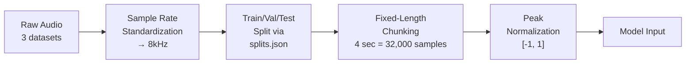
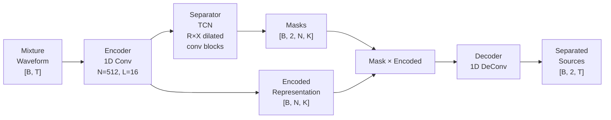
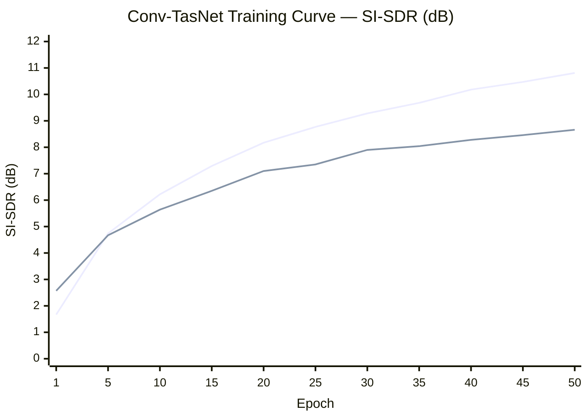

# 📄 Cocktail Party Speech Separation — Baseline Report

**Project:** Cocktail Party Problem — Monaural Speech Separation  
**Model:** Conv-TasNet (Convolutional Time-domain Audio Separation Network)  
**Date:** September 2026  

---

## 1. Problem Definition

### The Cocktail Party Problem
In a noisy environment with multiple simultaneous speakers, humans can focus on a single speaker — known as the **cocktail party effect**. Replicating this computationally is the goal of **monaural speech separation**: given a single-channel audio mixture containing two or more overlapping speakers, separate them into individual clean signals.

### Formal Definition

$$\text{mixture}(t) = \sum_{c=1}^{C} s_c(t)$$

Given mixture \(x(t)\), estimate individual sources \(\hat{s}_1(t), \hat{s}_2(t), \ldots, \hat{s}_C(t)\).

### Why It Matters
- **Hearing aids** — isolating target speaker in noisy environments
- **Voice assistants** — understanding commands with background speakers
- **Teleconferencing** — separating overlapping speakers
- **Transcription** — enabling accurate multi-speaker ASR

---

## 2. Literature Background

### Conv-TasNet (Luo & Mesgarani, 2019)

The foundational architecture for time-domain speech separation, published in IEEE/ACM Transactions on Audio, Speech, and Language Processing.

| Aspect | Detail |
|--------|--------|
| **Paper** | *Conv-TasNet: Surpassing Ideal Time-Frequency Magnitude Masking for Speech Separation* |
| **Key Innovation** | End-to-end waveform-domain separation — no STFT/spectrogram needed |
| **Dataset** | WSJ0-2mix (30h train, 10h val, 5h test, 8kHz) |
| **Result** | 15.3 dB SI-SDRi on WSJ0-2mix |
| **Loss** | SI-SDR with Permutation Invariant Training (PIT) |
| **Architecture** | Encoder → Temporal Convolutional Network → Decoder |

### Why Conv-TasNet Over U-Net?

| Feature | U-Net (Spectrogram) | Conv-TasNet (Waveform) |
|---------|---------------------|----------------------|
| **Domain** | Frequency (STFT magnitude) | Time (raw waveform) |
| **Phase** | Discarded → uses noisy phase for reconstruction | Learned implicitly by encoder/decoder |
| **Resolution** | Limited by STFT window/hop | Learned adaptive, high-resolution |
| **Standard metric** | Often MSE on spectrogram | SI-SDR on waveform (perceptually better) |
| **Literature standard** | Older approach | **Current standard for separation** |

---

## 3. Datasets

### 3.1 Data Sources

| Dataset | Source | Size | Files | Purpose |
|---------|--------|------|-------|---------|
| **Libri2Mix-8kHz-min** | [Kaggle](https://www.kaggle.com/datasets/unconscious/libri2mix-8khz-min) | 9.71 GB | 28,402 WAV | Pre-mixed 2-speaker separation data |
| **SPIB Noise (NOISEX-92)** | [SPIB](https://spib.linse.ufsc.br/noise.html) | 107.7 MB | 15 WAV | Environmental noise (15 types) |
| **TIMIT Corpus** | [Kaggle](https://www.kaggle.com/datasets/nltkdata/timitcorpus) | 30.5 MB | 160 WAV | Phonetically balanced clean speech |

### 3.2 Libri2Mix Structure

Libri2Mix is derived from **LibriSpeech** (clean read English speech). Two randomly selected speakers are mixed together at random SNRs (-5 to +5 dB) to create training pairs.

```
Libri2Mix/wav8k/min/
├── dev/              ← Used for train + val (no train-100 in Kaggle version)
│   ├── mix_clean/    ← Input: Speaker1 + Speaker2 mixed (3,000 files)
│   ├── s1/           ← Target: Speaker 1 clean (3,000 files)
│   └── s2/           ← Target: Speaker 2 clean (3,000 files)
├── test/             ← Held-out test set
│   ├── mix_clean/    ← 3,000 files
│   ├── s1/           ← 3,000 files
│   └── s2/           ← 3,000 files
└── test_noisy/       ← Test with background noise
    ├── mix_both/     ← Speakers + noise mixed
    ├── noise/        ← Background noise used
    ├── s1/, s2/      ← Clean targets
```

### 3.3 SPIB Noise Types (15 Environmental Noises)

| Category | Noise Types |
|----------|------------|
| **Stationary** | White Noise, Pink Noise, HF Channel Noise |
| **Speech-like** | Speech Babble |
| **Industrial** | Factory Floor 1, Factory Floor 2 |
| **Military/Aviation** | Buccaneer Jet (190 knots), Buccaneer Jet (450 knots), F-16 Cockpit |
| **Naval** | Destroyer Engine Room, Destroyer Operations Room |
| **Vehicle** | Leopard Tank, M109, Volvo 340 Interior, Machine Gun |

Each recording: **235 seconds**, mono, originally 19.98 kHz.

### 3.4 Audio Properties (Verified)

| Dataset | Sample Rate | Channels | Bit Depth | Avg Duration |
|---------|------------|----------|-----------|-------------|
| Libri2Mix | **8,000 Hz** | Mono | PCM_16 | 4–6 sec |
| SPIB Noise | **16,000 Hz** | Mono | PCM_16 | 235.23 sec |
| TIMIT | **16,000 Hz** | Mono | PCM_16 | 2–4 sec |

---

## 4. Preprocessing Pipeline

### 4.1 Key Issue: Missing Training Split

> [!IMPORTANT]
> The Kaggle Libri2Mix dataset only contained `dev/` (3,000 pairs) and `test/` (3,000 pairs). The `train-100/` split (~13,900 pairs) was **missing**. We used `dev/` split into train and validation.

### 4.2 Preprocessing Steps



| Step | Action | Detail |
|------|--------|--------|
| **1. SR Standardization** | SPIB: 16kHz → 8kHz, TIMIT: 16kHz → 8kHz | Using `scipy.signal.resample_poly` |
| **2. Data Split** | dev/ → 90% train + 10% val | Metadata-based (JSON), no file copying |
| **3. Chunking** | Fixed 4-second segments | Random crop (train), center crop (val/test) |
| **4. Normalization** | Peak normalize after mixing | `x = x / max(abs(x))`, sources scaled by same factor |

### 4.3 Final Data Distribution

| Split | Source | Pairs | Duration |
|-------|--------|-------|----------|
| **Train** | Libri2Mix dev (90%) | **2,700** | ~3.6 hours |
| **Val** | Libri2Mix dev (10%) | **300** | ~0.4 hours |
| **Test** | Libri2Mix test | **3,000** | ~4.2 hours |

---

## 5. Model Architecture

### 5.1 Conv-TasNet Overview



### 5.2 Component Details

#### Encoder
Learns a data-driven representation (replaces STFT):
$$\mathbf{w} = \text{ReLU}(\text{Conv1D}(\mathbf{x}))$$
- Input: raw waveform \([B, T]\)
- Output: encoded features \([B, N, K]\) where \(K = \lfloor(T - L)/S\rfloor + 1\)

#### Separator (Temporal Convolutional Network)
Generates masks for each speaker using stacked dilated convolutions:

| Layer | Operation |
|-------|-----------|
| **Layer Norm** | Normalize encoded features |
| **1×1 Conv** | Bottleneck: N → B dimensions |
| **R × X Dilated Conv Blocks** | Each block: PReLU → GroupNorm → Depthwise Conv (dilation=2^x) → PReLU → GroupNorm → 1×1 Conv → Skip + Residual |
| **1×1 Conv** | Output: Sc → N×C (masks for C speakers) |
| **Activation** | ReLU mask activation |

#### Decoder
Reconstructs waveform from masked features (replaces iSTFT):
$$\hat{s}_c = \text{ConvTranspose1D}(\mathbf{m}_c \odot \mathbf{w})$$

### 5.3 Baseline Model Configuration

| Parameter | Symbol | Value |
|-----------|--------|-------|
| Encoder filters | N | 512 |
| Filter length | L | 16 samples (2ms) |
| Encoder stride | S | 8 samples (1ms) |
| Bottleneck dim | B | 128 |
| Hidden dim | H | 512 |
| Skip-connection dim | Sc | 128 |
| Conv kernel size | P | 3 |
| Conv blocks per repeat | X | 8 |
| Repeats | R | 3 |
| Output speakers | C | 2 |
| Mask activation | — | ReLU |
| **Total parameters** | — | **1,415,216 (~1.4M)** |

---

## 6. Training Configuration

### 6.1 Loss Function: SI-SDR with PIT

**Scale-Invariant Signal-to-Distortion Ratio (SI-SDR):**

$$\text{SI-SDR} = 10 \log_{10} \frac{\|\langle\hat{s}, s\rangle s / \|s\|^2\|^2}{\|\hat{s} - \langle\hat{s}, s\rangle s / \|s\|^2\|^2}$$

**Permutation Invariant Training (PIT):** Since the model outputs 2 sources but we don't know the assignment (which output = which speaker), PIT evaluates all permutations and selects the best:

$$\mathcal{L} = -\max_{\pi \in \mathcal{P}} \frac{1}{C} \sum_{c=1}^{C} \text{SI-SDR}(\hat{s}_c, s_{\pi(c)})$$

For \(C=2\): only 2 permutations → efficient to compute.

### 6.2 Training Hyperparameters

| Hyperparameter | Value |
|---------------|-------|
| Optimizer | AdamW |
| Learning rate | 1×10⁻³ |
| Weight decay | 1×10⁻⁵ |
| LR scheduler | ReduceLROnPlateau (patience=5, factor=0.5) |
| Gradient clipping | Max norm = 5.0 |
| Batch size | 6 |
| Epochs | 50 |
| Chunk length | 4 seconds (32,000 samples) |
| GPU | NVIDIA T4 (Google Colab) |

---

## 7. Training Results

### 7.1 Learning Curve

| Epoch | Train SI-SDR (dB) | Val SI-SDR (dB) | Saved? |
|-------|-------------------|-----------------|--------|
| 1 | +1.67 | +2.57 | ✅ |
| 5 | +4.74 | +4.67 | ✅ |
| 10 | +6.22 | +5.64 | ✅ |
| 15 | +7.29 | +6.35 | ✅ |
| 20 | +8.17 | +7.10 | ✅ |
| 25 | +8.77 | +7.35 | ✅ |
| 30 | +9.28 | +7.90 | ✅ |
| 35 | +9.68 | +8.04 | |
| 40 | +10.18 | +8.28 | ✅ |
| 45 | +10.47 | +8.46 | ✅ |
| **50** | **+10.81** | **+8.66** | ✅ |



### 7.2 Training Observations
- **Steady convergence** — no sudden drops or instabilities
- **Train-Val gap: ~2.15 dB** at epoch 50 — indicates mild overfitting (expected with only 2,700 pairs)
- **Model still improving** at epoch 50 — not fully converged
- **Learning rate** stayed at 1×10⁻³ throughout (scheduler never triggered)
- **Training time: ~67 minutes** total (80 sec/epoch on T4 GPU)

---

## 8. Test Evaluation Results

### 8.1 Quantitative Metrics

| Metric | Value |
|--------|-------|
| **Mean SI-SDRi** | **+6.98 dB** |
| **Median SI-SDRi** | **+8.26 dB** |
| Test samples evaluated | 3,000 |
| Best model epoch | 50 |

> **SI-SDRi** (SI-SDR improvement) = SI-SDR of separated output − SI-SDR of raw mixture. Measures how much better the model makes the audio compared to doing nothing.

### 8.2 Result Distribution Analysis

| SI-SDRi Range | Interpretation |
|---------------|---------------|
| Median +8.26 dB | Most samples separated well |
| Mean +6.98 dB | Some hard cases pull the mean down |
| Gap (median − mean) = 1.28 dB | Right-skewed distribution with outlier failures |

Hard cases typically involve: speakers with very similar voices (same gender/pitch), very short utterances (heavy zero-padding), or extreme SNR ratios.

### 8.3 Comparison with Benchmarks

| Model | Data | Train Pairs | Params | SI-SDRi |
|-------|------|-------------|--------|---------|
| **Our Baseline** | **Libri2Mix-8kHz (dev only)** | **2,700** | **1.4M** | **+6.98 dB** |
| Conv-TasNet (paper) | WSJ0-2mix | 20,000+ | 5.1M | +15.3 dB |
| Conv-TasNet on LibriMix | Libri2Mix (full train-100) | 13,900 | 5.1M | ~+12–14 dB |

### 8.4 Gap Analysis

| Factor | Our Setup | Paper Setup | Impact |
|--------|-----------|-------------|--------|
| **Training data** | 2,700 pairs (~3.6h) | 20,000+ pairs (~30h) | **~5x less data** → biggest factor |
| **Model capacity** | 1.4M params | 5.1M params | **~3.6x smaller** → limits representational power |
| **Epochs** | 50 (still improving) | 100 (converged) | Under-trained |
| **Dataset** | Libri2Mix (diverse speakers) | WSJ0-2mix (read speech) | Different difficulty levels |

---

## 9. Audio Sample Evaluation

5 test samples were saved for qualitative evaluation:

| File | Description |
|------|-------------|
| `sample_XXX_mixture.wav` | Input: 2 speakers mixed together |
| `sample_XXX_clean_s1.wav` | Ground truth: Speaker 1 |
| `sample_XXX_clean_s2.wav` | Ground truth: Speaker 2 |
| `sample_XXX_estimated_s1.wav` | Model output: Estimated Speaker 1 |
| `sample_XXX_estimated_s2.wav` | Model output: Estimated Speaker 2 |

**Qualitative observations:**
- Model struggles with overlapping speakers of similar characteristics
- Separation artifacts audible — residual interference between estimated sources
- Performance insufficient for production use — serves as baseline for improvement

---

## 10. Key Takeaways

### ✅ What Worked
1. **End-to-end pipeline** — data download → preprocessing → training → evaluation fully automated
2. **PIT loss** — correctly handles speaker permutation ambiguity
3. **Consistent training** — stable convergence over 50 epochs, no training instabilities
4. **Infrastructure** — checkpoints saved to Google Drive, survives Colab disconnects

### ❌ What Needs Improvement
1. **Insufficient training data** — 2,700 pairs vs. 13,900+ required
2. **Undersized model** — 1.4M params vs. 5.1M in the paper
3. **Under-trained** — 50 epochs vs. 100 in the paper
4. **Perceptual quality** — SI-SDRi alone doesn't capture artifacts

---

## 11. Next Steps — Improved Model

| Change | Baseline → Improved |
|--------|---------------------|
| **Training data** | 2,700 pairs → **13,900 pairs** (generate full train-100 from LibriSpeech) |
| **Model size** | N=512,B=128 (1.4M) → **N=256,B=256 (~5.1M)** (paper config) |
| **Epochs** | 50 → **100** |
| **LR schedule** | patience=5 → **patience=3** (paper setting) |
| **Expected SI-SDRi** | +6.98 dB → **+10–13 dB** |

### Plan
1. Download LibriSpeech `train-clean-100` (~6.3 GB)
2. Generate Libri2Mix mixtures using official scripts (~13,900 pairs)
3. Train Conv-TasNet with paper hyperparameters for 100 epochs
4. Evaluate and compare with baseline
5. Phase 2: Add SPIB noise for speech enhancement task

---

## Appendix A: Project File Structure

```
cocktail_party_project/
├── data/
│   ├── libri2mix/           ← Libri2Mix-8kHz-min (Kaggle)
│   ├── spib_noise/          ← 15 NOISEX-92 noise files (16kHz)
│   ├── timit/               ← TIMIT clean speech (16kHz)
│   └── processed/
│       ├── splits.json      ← Train/Val/Test split metadata
│       ├── noise_8k/        ← SPIB resampled to 8kHz
│       └── timit_8k/        ← TIMIT resampled to 8kHz
├── checkpoints/
│   ├── tasnet_separation_best.pth  ← Best model weights
│   └── audio_samples/              ← 5 test audio samples
├── config.py                ← Hyperparameters
├── dataset.py               ← PyTorch Dataset
├── model.py                 ← Conv-TasNet architecture
├── utils.py                 ← SI-SDR loss + PIT
├── train.py                 ← Training loop
└── evaluate.py              ← Test evaluation
```

## Appendix B: Environment

| Component | Version |
|-----------|---------|
| Platform | Google Colab (T4 GPU) |
| Python | 3.x |
| PyTorch | 2.x (CUDA) |
| Audio I/O | soundfile, scipy |
| GPU | NVIDIA Tesla T4 (16 GB VRAM) |
| Storage | Google Drive (400 GB plan) |
